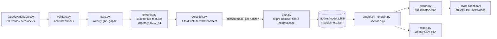
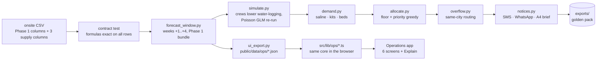

# Moshari — Architecture

All numbers come from `models/meta.json`, written by the code in `src/`.

## 1. Data flow



Training is offline. Before the dashboard starts, `npm run dev` runs `src/export.py`. That step loads `model.joblib` and computes every forecast the dashboard can show (60 wards × 131 weeks × 3 horizons × 7 rain scenarios), plus drivers and validation results, into two JSON files. Without a Python environment it falls back to the committed copy of that output. The dashboard only reads these files; it makes no network calls.

## 2. Features and the biology behind them

One row is a (ward, forecast week *t*). Features use weeks ≤ *t* only (`groupby(ward).shift(k ≥ 0)`); targets use `shift(-h)`. A test changes future weather and checks that past features do not move.

| Group | Features | Why |
|---|---|---|
| Rain | lags 0–8, 2/4/6-week sums, lags 2–4 sum, 4-week max, heavy-rain weeks (> ward's training P75) | breeding clock: eggs → adults in 7–14 days, then incubation |
| Temperature / humidity | lags 0–3, 4-week means, weeks in 25–32 °C | Aedes survival and thermal optimum |
| Ward | waterlogging, log density, sanitation | hyper-local vulnerability |
| Interactions | rain lags 2–4 × waterlogging / density / (1 − sanitation) | "same rain, different ward" |
| Season | sin/cos of ISO week | monsoon cycle |

**Lag evidence** (training weeks, Spearman correlation of rain *k* weeks ago with cases now; "season removed" subtracts each ward's mean for that ISO week):

| k (weeks) | 0 | 1 | 2 | **3** | 4 | 5 | 6 | 8 |
|---|---|---|---|---|---|---|---|---|
| raw | 0.64 | 0.70 | 0.77 | **0.79** | 0.74 | 0.67 | 0.62 | 0.52 |
| season removed | 0.04 | 0.04 | 0.15 | **0.33** | 0.21 | 0.04 | −0.02 | −0.01 |

## 3. Chronological validation

Never random, never shuffled. A 4-week purge gap (≥ the longest horizon) precedes every test block, so no training target falls in a test week. Test blocks are 52 weeks, one full monsoon each. Thresholds and medians are re-learned inside each fold. The model is chosen on the backtest only; `train.py` scores the holdout once.

```
Fold 1: [train 2016-01-04 → 2020-05-04] gap [test 2020-06-08 → 2021-05-31]
Fold 2: [train            → 2021-05-03] gap [test 2021-06-07 → 2022-05-30]
Fold 3: [train            → 2022-05-02] gap [test 2022-06-06 → 2023-05-29]
Fold 4: [train            → 2023-05-01] gap [test 2023-06-05 → 2024-05-27]
Final:  [train            → 2024-05-27] gap [HOLDOUT 2024-07-01 → 2025-12-29, scored once]
```

## 4. Model selection (mean backtest RMSE, cases per ward-week)

| Candidate | h = 2 | h = 3 | h = 4 |
|---|---|---|---|
| B1 ward mean | 4.549 | 4.553 | 4.579 |
| B2 seasonal naive (same week last year) | 3.854 | 3.854 | 3.889 |
| M1 Poisson GLM | **2.161** | **2.302** | 2.827 |
| M2 gradient boosting, Poisson loss¹ | 2.334 | 2.373 | 2.756 |
| M3 gradient boosting on log1p(cases)¹ | 2.389 | 2.557 | **2.743** (lr 0.03, monotonic) |

¹ Learning rates 0.03 / 0.05 / 0.1 were tried on the better boosting family per horizon; best shown.

- **Chosen:** M1 for 2 and 3 weeks; M3 for 4 weeks. Likely reasons:
  - The GLM's log link makes rain × vulnerability effects multiplicative, which suits the strong, smooth signal at 2–3 weeks.
  - At 4 weeks the driving rain has mostly not fallen yet, so season timing dominates, and trees fit its shape better.
- **Monotonic constraints** (+ recent rain, + waterlogging, − sanitation; directions checked in `docs/data_audit.md`) changed RMSE by −0.2% (inside the 2% budget), so they were kept.
- **Lag ablation:** removing rain from 1–8 weeks back raises RMSE by **24.8% / 2.9% / −1.8%** (h = 2 / 3 / 4). This matches the 3-week peak:
  - a 2-week forecast depends on last week's rain, a lagged feature;
  - a 3-week forecast depends on this week's rain, which the ablation keeps;
  - a 4-week forecast depends on rain that has not fallen yet.
- **Holdout:** RMSE 2.54 / 2.71 / 2.59 vs seasonal-naive 3.93 / 3.91 / 3.88. The model beats both baselines at every horizon.

## 5. Risk tiers, alerts, uncertainty, explanations

- **Tiers:** P50/P75/P90 of positive training targets: **5 / 9 / 14** cases. These give Low / Medium / High / Critical and are stored in the bundle.
- **Alerts** (High + Critical): forecasts are tiered against the thresholds × a decision scale (**0.8 / 0.8 / 0.7**). Each scale is the largest one that reaches ≥ 0.70 recall on the backtest, because a missed outbreak costs more than a false alarm.
  - Holdout recall: 0.696 / 0.661 / 0.818. Holdout precision: 0.59 / 0.55 / 0.41.
  - Reported as measured, not re-tuned on the holdout.
- **80% range:** gradient-boosting quantile models (α = 0.1 / 0.9), with 0 ≤ low ≤ forecast ≤ high.
  - Holdout coverage is 0.93–0.94 overall and 0.83–0.87 on weeks with cases.
  - Zero-case weeks inflate the overall figure.
- **Drivers:** each feature group is set to its training median and the model re-predicts. The signed change is that group's impact in cases, and it drives the bar chart and the reason sentence. Global importance comes from group permutation on the backtest folds.

## 6. Cost and performance controls

| Control | Measured |
|---|---|
| External API calls at runtime | **0**: no weather API; fonts bundled through npm; dev server bound to 127.0.0.1 |
| LLM tokens | **0** |
| Serialized model | `joblib` compress=3, **2.37 MB** |
| Training | offline: selection 164 s, final fit 19 s |
| Inference | all forecasts in one batched pass at launch (~10–25 s). What-if scenarios rescale every row's rain features at once, identical to rebuilding them (max difference 1e-14 cases). CLI: 60 wards in ~50–100 ms |
| Dashboard | loads 3.6 MB + 0.3 MB of JSON once; every click is an in-memory lookup |

**Production plan:**
- Pull weather once a day in one batched request for all wards, cached on disk by (date, location) with a time limit. Never call per ward.
- Re-run `src.export` and `src.report` weekly, and retrain monthly with a drift check.
- Any future LLM summary must be optional, capped at a token budget, and cached per (week, ward).

Limitations: see [MODEL_CARD.md](MODEL_CARD.md#limitations).

---

# Phase 2 — forecast to action (DengueOps)

Phase 2 turns the Phase 1 forecasts into decisions under scarcity: how much saline, how many test kits and beds each ward gets, where overflow patients go, where spray crews prevent the most cases, and the notice each ward receives. It runs with the network off.

## 7. Data flow



- **Python is the source of truth** (`src/ops/`, pure functions, no network or UI imports). `run_scenario` chains every module for one `Scenario`.
- **The browser runs a TypeScript port of the same core** (`src/lib/ops/`), so every slider recomputes the whole chain in about 30 ms with no server. `scripts/test-ops.test.ts` re-runs six Python fixture scenarios (`tests/fixtures/ops_parity.json`) and requires identical scenario ids, allocations, transfers, every SMS and WhatsApp text and the briefs byte for byte.
- **The forecasts are not recomputed in the browser.** `src/ops/ui_export.py` writes the 4-week window for all 105 as-of weeks (2024-01-01 → 2025-12-29) at full float precision; the browser recomputes everything downstream.

## 8. Formula sheet

| Quantity | Formula | Source |
|---|---|---|
| Supply units per week | `round_half_down(cases × k)`, k = 2.385 saline, 1.165 kits, 0.300 beds | dataset (exact on all 31,320 rows) |
| Window demand | saline, kits: Σ over weeks; beds: peak week | consumables vs reusable beds |
| Planned cases | expected forecast ("likely") or P90 ("bad case") | Planning Confidence |
| Forecast for week +k | week +1: h = 2 model from the week before the as-of week; +2/+3/+4: h = 2/3/4 models from the as-of week | Phase 1 bundle, leak-free (tested) |
| Risk | highest weekly tier in the window; cut-offs 5 / 9 / 14 × alert scale | Phase 1 training quantiles |
| Priority | 0.5 · risk_norm + 0.3 · density / densest + 0.2 · cases / max cases; risk_norm .25 / .5 / .75 / 1; ties by ward_id | PRD |
| Stock | floor(stock% × region need) | PRD |
| Equity floor | ceil(floor% × need) | PRD |
| Allocation | floors, then priority greedy until stock runs out | PRD |
| Alerts | CRITICAL: fill < 50%, or High+ risk and fill < 80%; WARNING: fill < 100% | PRD |
| Crew need | 0 / 1 / 2 / 3 by tier, +1 if water-logging ≥ 0.75 | PRD |
| Crew effect | reduction = r_max (1 − e^(−crews / 2)), r_max .15 / .30 / .45; ramp 0 / .5 / 1 / 1 for weeks +1..+4; wl' = max(0.22, wl (1 − reduction · ramp)) | PRD (assumption to calibrate) |
| Cases after spraying | baseline × GLM(rows \| wl') / GLM(rows \| wl) | model re-run |
| Beds | deficit = max(0, need − capacity); usable = capacity − floor(10% × capacity); headroom = max(0, usable − need) | PRD, buffer rounded down |
| scenario_id | sha1(sorted settings JSON + data hash + git commit)[:8] | PRD |

## 9. Why the decisions are optimal

- **Allocation.** After the floors, the problem is `max Σ priority_w · x_w` s.t. `Σ x_w ≤ stock − Σ floors`, `0 ≤ x_w ≤ need_w − floor_w`: a fractional knapsack with unit weights. Filling wards in priority order is its exact optimum. Property tests (hypothesis, 150 random cases) solve the same LP with scipy HiGHS and require equal objectives; others check that the stock is used exactly and that less stock never gives any ward more.
- **Floors that do not fit.** They are shared one unit at a time by Webster quotients `floor / (given + 0.5)`. A sequential method is house-monotone by construction. The PRD's largest remainder is not: floors (1, 3, 3) give [1, 1, 1] at stock 3 but [0, 2, 2] at stock 4 (kept as a regression test).
- **Routing.** No coordinates means every deficit ward reaches every donor in its city at equal cost, so the most patients that can be placed is min(total deficit, total headroom), the max flow. The greedy places exactly that; a property test compares it with `scipy.sparse.csgraph.maximum_flow` per city.
- **Crew effect.** Both Phase 1 effect models (h = 2, 3) are Poisson GLMs with positive per-unit coefficients on water-logging (+0.80) and on rain × water-logging (+0.0004). So log(cases) changes by `(b_wl + b_int · recent_rain) · Δwl`: lowering water-logging can only lower cases, and because the reduction is concave in crews, cases prevented are concave too. That makes the marginal-gain auto-suggest optimal (tested against brute force). The browser uses this closed form; a test shows it equals re-running the model to 1e-12.
- **Why not the 4-week model for the crew effect.** It is constrained to be monotone in water-logging, but not in the rain × water-logging interaction, which an intervention also lowers. Cutting water-logging by 10–45% raised its forecast on 269 of 6,240 ward-weeks (May–Oct 2025), by at most 0.5 case. Weeks +4 therefore take the 3-week GLM's ratio, and P90 is scaled by the same ratio.

## 10. Measured effects (as-of 2025-06-30)

- 10 / 20 / 30% lower water-logging → 5.5 / 10.6 / 15.5% fewer predicted cases (2-week model, May–Oct 2025). The PRD's quick check found 3.5 / 10.8 / 14.3%.
- 30 crews placed by auto-suggest over a 4-week window prevent 77 of 2,483 expected cases (3.1%) and avoid 184 saline bags and 91 kits. Two wards (DNCC_Ward_04, DSCC_Ward_14) already have the lowest index in the data (0.22), so no benefit is modelled there.
- Demo pack (60% stock): 36 wards critical, saline short 1,351 bags, kits short 660.

## 11. Assumptions and where each number comes from

| Value | Source | Where to change it |
|---|---|---|
| 2.385 / 1.165 / 0.300 per case, round half down | dataset | `src/config.py` `SUPPLY_PER_1000_CASES` |
| Tier cut-offs 5 / 9 / 14, alert scale 0.8 / 0.8 / 0.7 | Phase 1 training data | model bundle |
| Bed capacity 1–5 beds | derived: P75 of each ward's non-zero bed need, training weeks only | `src/ops/capacity.py`; replace with real counts |
| 10% bed buffer, rounded down to whole beds | assumption (team decision) | `src/ops/overflow.py` |
| r_max .15 / .30 / .45, c_sat 2, ramp 0 / .5 / 1 / 1 | assumption (PRD); ramp follows the 3-week rain lag | `src/ops/simulate.py` |
| Water-logging floor 0.22 | dataset minimum (no extrapolation) | `src/ops/simulate.py` |
| Crew pool 20 | assumption (the PRD leaves it open) | `src/ops/scenario.py` |
| Equity floor 15%, stock 30–100% | policy (PRD) | sliders |

## 12. Where we differ from the PRD, and why

| PRD | Implemented | Evidence |
|---|---|---|
| round half up, "exact on all 13,144 non-zero rows" | **round half down** | beds hit exact .5 ties 1,197 times (5, 15, 25, 35 cases); half up misses all 1,197, half down matches all 31,320 rows (`tests/test_onsite_dataset.py`) |
| largest-remainder floors | Webster-sequential | largest remainder breaks "less stock never gives more" (counterexample above) |
| usable = floor(0.9 × capacity) | capacity − floor(0.1 × capacity) | with 1–5 bed wards the PRD rule took a bed from every ward and placed 1 patient over Jun–Aug 2025; rounding the buffer down placed 15 |
| crews re-run each week's own model | ratio from the 2-/3-week GLMs | the 4-week and P90 models are not monotone in the intervention (section 9) |
| Streamlit, Jinja2, WeasyPrint, networkx, parquet | React (Phase 1 site), plain template functions, print-to-PDF HTML, scipy max-flow, CSV/JSON | no new runtime dependency; the Phase 1 look and URL are kept |

## 13. Offline design

- No network imports in `src/ops` (tested). Fonts, charts and data are bundled; the browser makes no request after loading `public/data/ops/*.json`.
- `tests/test_offline.py` blocks `socket.socket`, `create_connection` and `getaddrinfo`, rebuilds the committed `exports/` pack from `exports/scenario.json` and requires all 186 files to match byte for byte. `python -m src.ops.selfcheck` prints `OFFLINE MODE ✓ model ✓ data ✓ templates ✓`; `make offline-check` runs both.
- Forecast fallback chain (`src/ops/fallback.py`): Phase 1 model → cached forecast (`forecasts.json`) → seasonal mean of the same ISO week in earlier years (always available, leak-free). It steps down only when the model cannot load, and reports which source it used.
- Portability: the data hash reads CRLF as LF (git `autocrlf` checkouts), and `.gitattributes` keeps `exports/` byte-exact and out of Git LFS.

## 14. Phase 2 limitations

- Bed capacity is a proxy, crew effectiveness is assumed, and ward indices are fixed in the data, so the crew effect is model-based sensitivity, not a causal estimate.
- Forecast error passes straight into decisions. The 2-week model over-forecasts the 2025 peak (901 forecast vs 373 actual cases for 2025-07-07); the dashboard shows forecast and actual side by side.
- Wards in a city peak together, so same-city routing rarely has donors at the peak; the system's answer is to escalate (`CITY_SATURATED`), which is itself a finding.
- No geography: transfers have equal cost within a city and never cross cities.
