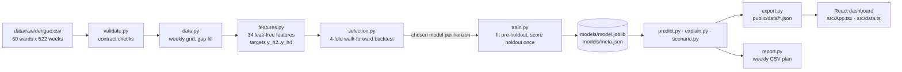

# Moshari — Architecture

All numbers come from `models/meta.json`, written by the code in `src/`.

## 1. Data flow



Training is offline. Before the dashboard starts, `npm run dev` runs `src/export.py`. That step loads `model.joblib` and computes every forecast the dashboard can show (60 wards × 131 weeks × 3 horizons × 7 rain scenarios), plus drivers and validation results, into two JSON files. Without a Python environment it falls back to the committed copy of that output. The dashboard only reads these files; it makes no network calls.

## 2. Features and the biology behind them

One row is a (ward, forecast week *t*). Features use weeks ≤ *t* only (`groupby(ward).shift(k ≥ 0)`); targets use `shift(-h)`. A test changes future weather and checks that past features do not move.

| Group | Features | Why |
|---|---|---|
| Rain | lags 0–8, 2/4/6-week sums, lags 2–4 sum, 4-week max, heavy-rain weeks (> ward's training P75) | breeding clock: eggs → adults in 7–14 days, then incubation |
| Temperature / humidity | lags 0–3, 4-week means, weeks in 25–32 °C | Aedes survival and thermal optimum |
| Ward | waterlogging, log density, sanitation | hyper-local vulnerability |
| Interactions | rain lags 2–4 × waterlogging / density / (1 − sanitation) | "same rain, different ward" |
| Season | sin/cos of ISO week | monsoon cycle |

**Lag evidence** (training weeks, Spearman correlation of rain *k* weeks ago with cases now; "season removed" subtracts each ward's mean for that ISO week):

| k (weeks) | 0 | 1 | 2 | **3** | 4 | 5 | 6 | 8 |
|---|---|---|---|---|---|---|---|---|
| raw | 0.64 | 0.70 | 0.77 | **0.79** | 0.74 | 0.67 | 0.62 | 0.52 |
| season removed | 0.04 | 0.04 | 0.15 | **0.33** | 0.21 | 0.04 | −0.02 | −0.01 |

## 3. Chronological validation

Never random, never shuffled. A 4-week purge gap (≥ the longest horizon) precedes every test block, so no training target falls in a test week. Test blocks are 52 weeks, one full monsoon each. Thresholds and medians are re-learned inside each fold. The model is chosen on the backtest only; `train.py` scores the holdout once.

```
Fold 1: [train 2016-01-04 → 2020-05-04] gap [test 2020-06-08 → 2021-05-31]
Fold 2: [train            → 2021-05-03] gap [test 2021-06-07 → 2022-05-30]
Fold 3: [train            → 2022-05-02] gap [test 2022-06-06 → 2023-05-29]
Fold 4: [train            → 2023-05-01] gap [test 2023-06-05 → 2024-05-27]
Final:  [train            → 2024-05-27] gap [HOLDOUT 2024-07-01 → 2025-12-29, scored once]
```

## 4. Model selection (mean backtest RMSE, cases per ward-week)

| Candidate | h = 2 | h = 3 | h = 4 |
|---|---|---|---|
| B1 ward mean | 4.549 | 4.553 | 4.579 |
| B2 seasonal naive (same week last year) | 3.854 | 3.854 | 3.889 |
| M1 Poisson GLM | **2.161** | **2.302** | 2.827 |
| M2 gradient boosting, Poisson loss¹ | 2.334 | 2.373 | 2.756 |
| M3 gradient boosting on log1p(cases)¹ | 2.389 | 2.557 | **2.743** (lr 0.03, monotonic) |

¹ Learning rates 0.03 / 0.05 / 0.1 were tried on the better boosting family per horizon; best shown.

- **Chosen:** M1 for 2 and 3 weeks; M3 for 4 weeks. Likely reasons:
  - The GLM's log link makes rain × vulnerability effects multiplicative, which suits the strong, smooth signal at 2–3 weeks.
  - At 4 weeks the driving rain has mostly not fallen yet, so season timing dominates, and trees fit its shape better.
- **Monotonic constraints** (+ recent rain, + waterlogging, − sanitation; directions checked in `docs/data_audit.md`) changed RMSE by −0.2% (inside the 2% budget), so they were kept.
- **Lag ablation:** removing rain from 1–8 weeks back raises RMSE by **24.8% / 2.9% / −1.8%** (h = 2 / 3 / 4). This matches the 3-week peak:
  - a 2-week forecast depends on last week's rain, a lagged feature;
  - a 3-week forecast depends on this week's rain, which the ablation keeps;
  - a 4-week forecast depends on rain that has not fallen yet.
- **Holdout:** RMSE 2.54 / 2.71 / 2.59 vs seasonal-naive 3.93 / 3.91 / 3.88. The model beats both baselines at every horizon.

## 5. Risk tiers, alerts, uncertainty, explanations

- **Tiers:** P50/P75/P90 of positive training targets: **5 / 9 / 14** cases. These give Low / Medium / High / Critical and are stored in the bundle.
- **Alerts** (High + Critical): forecasts are tiered against the thresholds × a decision scale (**0.8 / 0.8 / 0.7**). Each scale is the largest one that reaches ≥ 0.70 recall on the backtest, because a missed outbreak costs more than a false alarm.
  - Holdout recall: 0.696 / 0.661 / 0.818. Holdout precision: 0.59 / 0.55 / 0.41.
  - Reported as measured, not re-tuned on the holdout.
- **80% range:** gradient-boosting quantile models (α = 0.1 / 0.9), with 0 ≤ low ≤ forecast ≤ high.
  - Holdout coverage is 0.93–0.94 overall and 0.83–0.87 on weeks with cases.
  - Zero-case weeks inflate the overall figure.
- **Drivers:** each feature group is set to its training median and the model re-predicts. The signed change is that group's impact in cases, and it drives the bar chart and the reason sentence. Global importance comes from group permutation on the backtest folds.

## 6. Cost and performance controls

| Control | Measured |
|---|---|
| External API calls at runtime | **0**: no weather API; fonts bundled through npm; dev server bound to 127.0.0.1 |
| LLM tokens | **0** |
| Serialized model | `joblib` compress=3, **2.37 MB** |
| Training | offline: selection 164 s, final fit 19 s |
| Inference | all forecasts in one batched pass at launch (~10–25 s). What-if scenarios rescale every row's rain features at once, identical to rebuilding them (max difference 1e-14 cases). CLI: 60 wards in ~50–100 ms |
| Dashboard | loads 3.6 MB + 0.3 MB of JSON once; every click is an in-memory lookup |

**Production plan:**
- Pull weather once a day in one batched request for all wards, cached on disk by (date, location) with a time limit. Never call per ward.
- Re-run `src.export` and `src.report` weekly, and retrain monthly with a drift check.
- Any future LLM summary must be optional, capped at a token budget, and cached per (week, ward).

Limitations: see [MODEL_CARD.md](MODEL_CARD.md#limitations).
