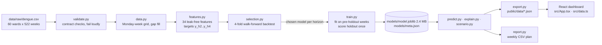

# Moshari — Architecture

All numbers below come from `models/meta.json`, written by the code in `src/`.

## 1. Data flow



Training is offline. `src/export.py` precomputes everything the dashboard can show (60 wards × 131 weeks × 3 horizons × 7 rain scenarios, plus drivers and validation results) into two static JSON files. The React dashboard only reads them and makes no network calls; the CLI loads the bundle and the CSV.

## 2. Features and the biology behind them

One row is a (ward, forecast week *t*). Every feature uses weeks ≤ *t* only (`groupby(ward).shift(k ≥ 0)`); targets are `shift(-h)`. A test perturbs future weather and checks that past features do not change.

| Group | Features | Why |
|---|---|---|
| Rain | `rain_lag_0..8`, 2/4/6-week sums, `rain_sum_lag2_4`, `rain_max_4`, heavy-rain weeks in the last 4 (above the ward's training P75) | breeding clock: eggs → adults in 7–14 days, then infection and incubation |
| Temperature | `temp_lag_0..3`, 4-week mean, weeks in 25–32 °C | Aedes thermal optimum |
| Humidity | `hum_lag_0..3`, 4-week mean | mosquito survival |
| Ward | waterlogging index, log density, sanitation score | hyper-local vulnerability |
| Interactions | `rain_sum_lag2_4` × waterlogging / log density / (1 − sanitation) | "same rain, different ward" |
| Season | sin/cos of ISO week | monsoon cycle without a 52-level category |

**Lag evidence** (training weeks only, pooled Spearman of rain *k* weeks ago vs cases now):

| k (weeks) | 0 | 1 | 2 | **3** | 4 | 5 | 6 | 8 |
|---|---|---|---|---|---|---|---|---|
| raw | 0.64 | 0.70 | 0.77 | **0.79** | 0.74 | 0.67 | 0.62 | 0.52 |
| season removed | 0.04 | 0.04 | 0.15 | **0.33** | 0.21 | 0.04 | −0.02 | −0.01 |

"Season removed" subtracts each ward's mean for that ISO week from both series, so the monsoon cycle alone cannot create the link. Outside lags 2–4 it is near zero.

## 3. Chronological validation

Never random, never shuffled. Every test block is preceded by a 4-week purge gap (≥ the longest horizon), so no training target falls in a test week.

```
2016-01-04                                                           2024-05-27 | gap | 2024-07-01 → 2025-12-29
Fold 1: [train → 2020-05-04] gap [test 2020-06-08 → 2021-05-31]
Fold 2: [train → 2021-05-03] gap [test 2021-06-07 → 2022-05-30]
Fold 3: [train → 2022-05-02] gap [test 2022-06-06 → 2023-05-29]
Fold 4: [train → 2023-05-01] gap [test 2023-06-05 → 2024-05-27]
Final:  [train → 2024-05-27]                                       gap [HOLDOUT, touched once]
```

- Test blocks are 52 weeks, so each fold covers one full monsoon season.
- Data-driven thresholds (heavy-rain P75 per ward, tier quantiles, imputation medians) are re-learned inside every fold from that fold's training weeks.
- Model choice uses the backtest only. The holdout is scored once, by `src/train.py`.

## 4. Model selection (mean backtest RMSE over 4 folds, cases per ward-week)

| Candidate | h = 2 | h = 3 | h = 4 |
|---|---|---|---|
| B1 ward mean | 4.549 | 4.553 | 4.579 |
| B2 seasonal naive (same week last year) | 3.854 | 3.854 | 3.889 |
| M1 Poisson GLM | **2.161** | **2.302** | 2.827 |
| M2 gradient boosting, Poisson loss¹ | 2.334 | 2.373 | 2.756 |
| M3 gradient boosting on log1p(cases)¹ | 2.389 | 2.557 | 2.748 → **2.743** with monotonic constraints |

¹ Learning rates 0.03 / 0.05 / 0.1 were tried on the better boosting family per horizon (M2 at 2–3 weeks, M3 at 4 weeks), and the best is shown; the other family ran at 0.05.

Chosen: **M1 for 2 and 3 weeks, M3 (learning rate 0.03, monotonic) for 4 weeks.**

- The search was light, as planned: three families, then the learning-rate check above, with fixed tree settings (400 iterations, 31 leaves, min 20 samples per leaf, L2 = 1.0).
- **Likely why the GLM wins at 2–3 weeks:** with a log link, rain × vulnerability effects are multiplicative, which is how outbreaks grow, and the signal is strong and smooth, so a regularised linear model generalises better than trees.
- **Likely why boosting wins at 4 weeks:** the rain that drives cases 4 weeks out mostly has not fallen yet, so timing in the season matters more and its non-linear shape favours trees.
- **Monotonic constraints** (+ recent rain, + waterlogging, − sanitation; directions confirmed in `docs/data_audit.md`) were tested where boosting won. They changed RMSE by −0.2%, inside the 2% budget, so they were kept.
- **Lag ablation:** removing every feature built from rain 1–8 weeks back raises RMSE by **24.8%** (h=2), **2.9%** (h=3) and **−1.8%** (h=4). This matches the 3-week peak: for a 2-week forecast the driving rain is last week's (a lagged feature). For a 3-week forecast it is this week's rain, which the ablation keeps. For a 4-week forecast it has not fallen yet.

Holdout (scored once): RMSE 2.54 / 2.71 / 2.59 vs seasonal-naive 3.93 / 3.91 / 3.88 — the model beats both baselines at all horizons.

## 5. Risk tiers, alerts and uncertainty

- **Tiers.** Thresholds are P50/P75/P90 of positive training targets: **5 / 9 / 14** cases. That gives Low < 5 ≤ Medium < 9 ≤ High < 14 ≤ Critical. They are stored in the bundle and never recomputed at inference.
- **Alert policy.** Missing an outbreak costs more than a false alarm. At the plain thresholds, backtest alert recall was only 0.52 / 0.52 / 0.40. So predicted values are tiered against thresholds × a decision scale: the largest scale whose backtest recall is ≥ 0.70. The chosen scales are **0.8 / 0.8 / 0.7**, giving backtest recall 0.75 / 0.72 / 0.71 at precision 0.66 / 0.64 / 0.52.
- **On the holdout**, recall is 0.696 / 0.661 / 0.818 and precision 0.59 / 0.55 / 0.41. Reported as is; not re-tuned on the holdout.
- **Uncertainty.** Separate gradient-boosting quantile models (α = 0.1, 0.9) per horizon give the 80% range, clipped so 0 ≤ low ≤ forecast ≤ high.
  - Holdout coverage is 0.93 / 0.93 / 0.94 on all weeks: too wide, because 58% of weeks have zero cases and a lower bound of 0 always covers them.
  - On weeks with cases it is 0.84 / 0.83 / 0.87, inside the 0.70–0.90 target.
- **Explanations, no SHAP dependency.**
  - Local: set one feature group to its training median and re-predict; the difference is that group's signed impact in cases. It drives the bar chart and the sentence.
  - Global: group permutation importance on the backtest folds. Rain leads at h=2; the season leads at h=3 and h=4, with rain second.

## 6. Cost and performance controls

| Control | Measured |
|---|---|
| External API calls at runtime | **0** (no weather API; fonts bundled through npm instead of a web-font service; dev server bound to 127.0.0.1) |
| LLM tokens | **0** |
| Model bundle | `joblib` compress=3, **2.37 MB**, committed |
| Training | offline: selection 164 s, final fit 19 s (laptop, 16 logical cores) |
| Inference | precomputed offline by `src/export.py` in **~10 s**; the what-if scenarios rescale the rain features of all rows at once (identical to rebuilding them: max difference 1e-14 cases). Python CLI: all 60 wards in ~50–100 ms |
| Dashboard | loads `dashboard.json` (3.6 MB) and `validation.json` (0.3 MB) once; every click is an in-memory lookup, no model call |

**Production plan (stage 2).**
- Pull weather once per day in one batched request for all wards.
- Cache it on disk keyed by (date, location) with a TTL. Never call per ward.
- Rebuild features, re-run `python -m src.export` and `python -m src.report` on a weekly schedule, and email the CSV.
- Retrain monthly with `src.selection` + `src.train`, and alert if holdout-style metrics drift.
- Any future LLM summary must stay optional, capped at a fixed token budget, and cached per (week, ward).

## 7. Limitations

- The model was trained on data up to 2024-05-27 (the PRD keeps the holdout untouched). A production refit would include the holdout years.
- Ward vulnerability scores are constant per ward, so the model learns differences between wards, not changes within a ward.
- Past case counts are deliberately not features (weather-driven risk, explainable drivers), which caps short-horizon accuracy.
- At h=4 only one rain feature is monotonic-constrained. In 1 of 120 ward-week checks at h=4 (360 across all horizons), doubling recent rain lowered the forecast slightly (11.26 → 10.97 cases).
- 52-week "same week last year" is one week off in 53-week ISO years (baseline only).
